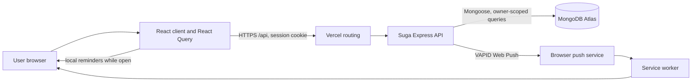
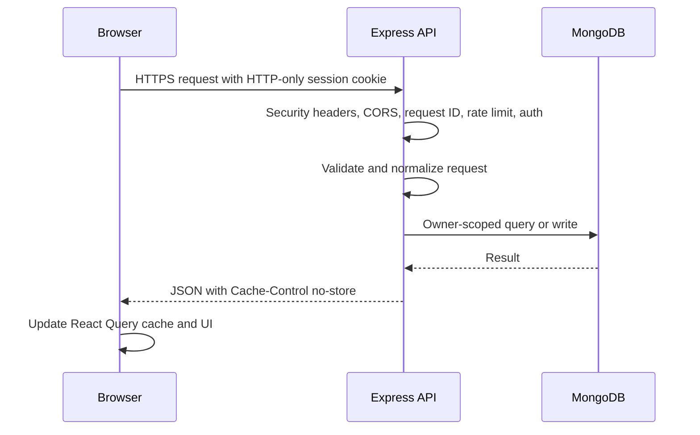
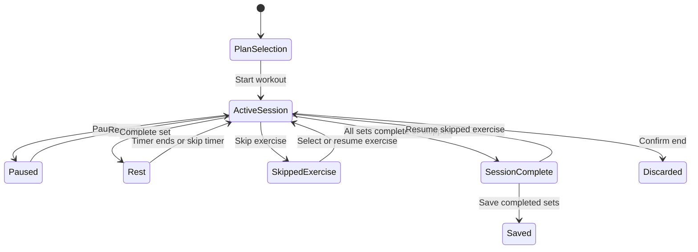
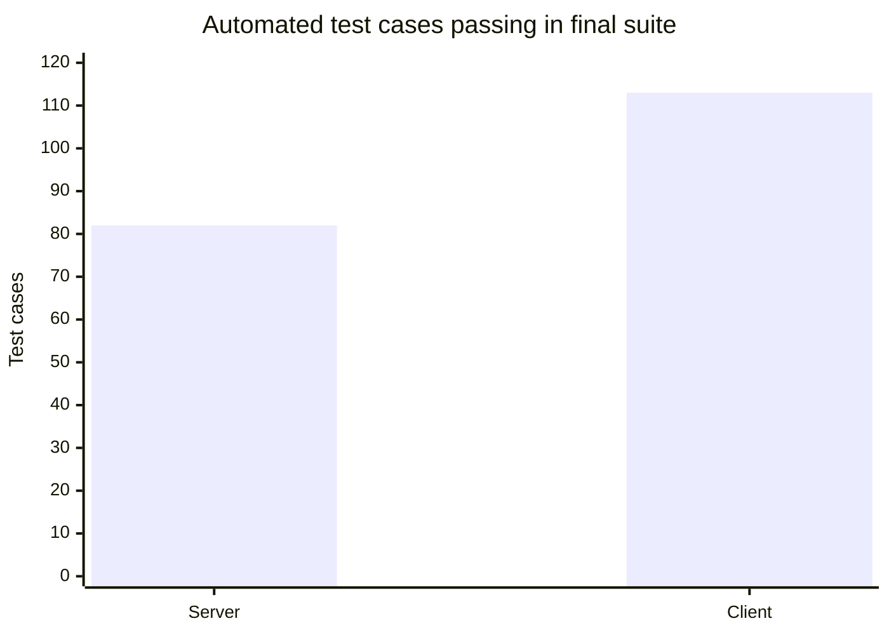

# IronTrack Application Guide and Architecture

Updated November 5, 2026

This guide explains the application as implemented: what each area does, how browser requests reach the API and database, how workout sessions are recorded, where reminders run, and what operational boundaries matter for the current free-tier deployment. It is intended for the project owner maintaining the app.

## At a glance

IronTrack is a React and TypeScript web app backed by an Express API and MongoDB. Vercel serves the client and routes `/api/*` to the Suga API. MongoDB Atlas stores account and fitness data. The browser service worker handles background push notifications; local reminder timers work only while the site is open.

The current production health endpoint responded `ok` with the database `connected` on November 5, 2026. The notification config endpoint requires an authenticated session, so that unauthenticated health check did not verify the VAPID configuration. The owner reports the keys are set. No real push was sent as part of this source audit.

## Product areas

| Area | What a user can do | Main data and API area |
| --- | --- | --- |
| Sign in and account | Register, verify email, sign in, refresh and revoke sessions, recover password, update profile, delete account | `auth` routes, user, challenge, and session models |
| Home | See today's routine and latest training summary, then jump into the routine | routine day and workout log queries |
| Routine | Create tasks, schedule blocks, complete tasks, manage an active/queued task, snooze or extend a block, review events | `/routine/*`, task, occurrence, completion, reminder, event models |
| Schedule manager | Edit day schedules and copy a schedule to another day | `/routine/schedules/*` |
| Workout | Build named workout plans, add/edit exercise definitions, assign plans to weekdays, run a timed session, log sets, pause, skip or resume exercises, save offline, and review recent sessions | `/workout-*`, exercise library, plan, program, and log models |
| Workout statistics | Review paginated session history, volume, muscle-group distribution, training frequency, and estimated strength records | `/workout-logs?limit=200&cursor=…`, client-side chart calculations |
| Exercise details | Inspect recorded sets and progress for one exercise | exercise route and workout logs |
| Weight | Add, edit, remove, and review body-weight records in kg or lb | `/weight-logs` |
| Analytics | View routine and activity summaries over a selected date range | `/analytics` and routine events |
| Wellness | Track water and movement, set reminder categories, choose notification sound, test sound, test a notification when enabled | `/wellness`, notification preferences |
| Settings | Edit profile and training defaults, configure prayer anchors, enable/disable notifications, inspect/revoke sessions, delete account | `/auth/me`, `/auth/sessions`, notification subscription routes |

## Request and data flow

The shared API client uses a 15-second request timeout, credentials, and a single-flight session refresh after an eligible 401 response. React Query uses a 30-second default stale time, one retry, and no automatic window-focus refetch. Mutations use no retries by default. Account-bound offline actions are stored in IndexedDB with a local-storage fallback and are replayed only for the matching account. A Web Lock serializes sync across browser tabs when supported; a short local-storage lease is the fallback. Workout history uses owner-scoped keyset pagination by date, completion time, and ID, with explicit Load older controls.

## Workout flow

At workout start, the client snapshots the plan so edits made later do not mutate the live session. Set values are prefilled from the latest workout for that plan, then from plan targets. Session state persists by account in local storage so refresh can restore an in-progress session without crossing account boundaries. The pause action freezes elapsed, exercise, rep, and rest time. Completing a set marks it locally and starts the configured rest. Only completed sets are submitted. Offline workout logs use a unique action ID so a retry can be recognized by the API.

Weight inputs now follow the selected kg/lb preference. Workout data remains stored in kilograms; pound input is converted to kg before saving, so historical volume and progression remain consistent. Existing logs were already treated as kilograms by the stats screens. If every exercise is skipped, the user can end the session without creating a misleading empty workout log.

## Notification behavior

Settings is the single master control. The browser permission prompt is requested only while permission is undecided. If the API is configured with VAPID and the user is signed in, Settings creates or reuses the browser push subscription. If push setup fails, local notifications remain enabled and the UI reports that background push did not connect. Turning the master control off disables local delivery immediately; server subscription cleanup is best effort and is retried when Settings is opened. Wellness controls reminder categories and sound but does not request permission.

The server checks reminder schedules every minute and materializes each due reminder as a MongoDB record with a stable key, `dueAt`, delivery deadline, status, attempt count, and retry time. It catches up due events for 15 minutes after a missed tick, retries transient push failures with a bounded backoff, and keeps delivery records for 60 days. A MongoDB scheduler lease coordinates API instances; each event is also atomically claimed, and per-device delivery keys suppress duplicates after a crash or retry. The scheduler stores a checkpoint so ordinary ticks only scan new minute slots. Task lookups are grouped by user and timezone. Routine reminders, workout reminders, water/movement reminders, prayer-time reminders, and block-end prompts use this path when VAPID is configured. Local browser scheduling covers in-app reminders while the app is open.

Free hosting is best effort. A stopped API, disconnected database, paused browser, expired endpoint, blocked OS/browser permission, or a missed minute can delay or prevent delivery. The server does not promise exact-time or 24/7 delivery.

## API map

All domain routes except health are under `/api` and require authentication after the router's auth middleware. Auth routes have their own public and protected policies.

| Domain | Main operations |
| --- | --- |
| Auth | register/login/logout/refresh, verify/resend, password recovery/reset, current user, sessions, account deletion |
| Notifications | config/status, subscribe/update preferences/unsubscribe, rate-limited test push |
| Routine | schedules, daily view, task CRUD/completion, occurrence start/queue/extend/snooze, event analytics |
| Workout | plans, exercise library, weekly program, logs, week assignments |
| Weight | list/create/update/delete logs |
| Wellness | list history and save a dated check-in |
| Analytics | read a date-range summary |

## Security and data handling

- Session cookies are HTTP-only and use same-site protection; cookie-authenticated mutations also validate Origin or Referer against configured app origins. Production startup requires a separate `AUTH_REFRESH_SECRET` of at least 32 bytes; rotating refresh tokens are validated server-side.
- Passwords use bcrypt; verification and password-reset tokens are stored as digests, are single-use, and expire.
- Protected writes are account-scoped and validated. Global API and account write limits are in memory, so multi-replica horizontal scaling would need shared rate-limit storage or gateway enforcement.
- Failed offline actions remain visible for retry or discard. Pending actions older than 30 days are paused for owner review instead of being replayed automatically.
- Account deletion cascades through account-owned data in a transaction. This depends on MongoDB transaction support.
- API JSON bodies are limited to 1 MB; responses are marked no-store; Helmet, CORS allowlisting, and Mongo sanitization are enabled.
- Production secrets belong only in the provider's secret environment. Never commit or paste MongoDB URIs, JWT secrets, email credentials, or VAPID private keys.
- `npm audit --omit=dev` reported zero known production dependency vulnerabilities on November 5, 2026. This is a point-in-time result, not a guarantee about future advisories.

## Free-tier operating boundaries

The Suga Free pricing page lists one project/environment, 0.1 vCPU, 256 MiB RAM, 1 GB storage, and a single replica. MongoDB Atlas Free lists 0.5 GB data/index storage, up to 100 operations per second, up to 500 connections, and 10 GB in/out transfer in each rolling seven-day window. These shared-tier limits are not performance or availability guarantees. Check the providers' current pages before relying on them because plan details can change.

Source: local Vitest suites, November 5, 2026. This chart counts automated test cases; it is not a production load test or uptime measurement.

No real database-backed 10-user load test was possible in this environment because `LOAD_MONGO_URI` was not configured. The existing `server/scripts/database-load.mjs` creates synthetic users in a dedicated `irontrack_loadtest` database and drops that database afterward. Use only a disposable database URI. Do not aim load-test cleanup at production.

## Maintenance notes

- Build client and server with `npm run build` at the repository root.
- Run server and client tests with `npm test`.
- Run the server's isolated database load profile only after configuring `LOAD_MONGO_URI` for a disposable database.
- Keep Suga at one API replica while its in-process interval scheduler is active. The lease is a safety guard, not a replacement for a durable queue or renewable job lease.
- Review Suga memory/restarts and Atlas connections, operations, storage, and transfer from provider dashboards. No live resource metrics were available during this code review.
- Create a manual `mongodump` export outside the application container, encrypt and retain it privately, and periodically test restore to a separate database. Do not put backups in this repository.

## Code map

| Path | Responsibility |
| --- | --- |
| `client/src/App.tsx` | Authenticated app data, route composition, and mutations |
| `client/src/pages/workout/WorkoutPage.tsx` | Workout plan editor and active workout session |
| `client/src/pages/workout/WorkoutStatsPage.tsx` | Workout summaries, charts, history, and PR calculations |
| `client/src/pages/settings/SettingsPage.tsx` | Account settings and notification master switch |
| `client/src/components/NotificationScheduler.tsx` | Local reminders while the client is open |
| `server/src/app.ts` | Express middleware, health, API rate limit, and DB gate |
| `server/src/routes/routes.ts` | Authenticated domain route map |
| `server/src/services/notifications/push.service.ts` | Due-event creation, bounded catch-up and retries, Web Push delivery, idempotency, and scheduler leases |
| `server/src/services/workout/workout.service.ts` | Workout program, exercise library, and workout log persistence |
| `server/src/utils/workoutValidation.ts` | Workout payload validation and derived totals |
| `server/src/db/db.ts` | MongoDB connection and slow/failed command logging |

The comments added to the more stateful workout functions explain their responsibility at the point of use. Prefer short comments that clarify time/unit/storage invariants; avoid comments that merely repeat the line below them.
